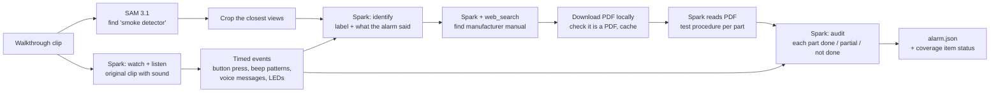

# Smoke alarm agent: design

## Why
Seeing a smoke alarm in a walkthrough says nothing about whether it works. A real inspection presses the test
button and checks the alarm responds as its manufacturer intends. Many alarms need more than one signal per test:
a smoke + CO combination unit, for example, runs a FIRE part and then a CO part. The coverage check could only
say a detector was seen and whether the inspector said "tested". This agent answers:

- Which alarm is this?
- What does its manual say a correct test sounds like?
- Was the test done, and was it complete?

## Flow



All model calls go to Meta models: SAM 3.1 and Muse Spark (`muse-spark-1.3`) with its built-in `web_search` tool.

## Steps (`secondinspector/alarm.py`)

| Step | Function | Model | Output |
|---|---|---|---|
| Find | `find_alarm`, `best_views` | SAM 3.1 (cached per phrase) | Up to 4 crops from the frames where the alarm's box is largest, at least 2 s apart. If SAM finds nothing, evenly spaced whole frames are used. |
| Listen | `heard` | Spark, video input with sound | Timed events from the alarm (voice messages, beep patterns, chirps, LEDs) and from the inspector (speech, button press or hold). |
| Identify | `identify` | Spark vision | Brand, model, kind (smoke / co / smoke_co / heat), power, voice, label text, visual features, confidence. What the alarm was heard saying is included, so "carbon monoxide" marks a combo unit even when the label is unreadable. |
| Find manual | `find_manual`, `rank_manuals` | Spark + `web_search` | URLs the search cited and saw. PDFs on the manufacturer's own domain rank first, then other PDFs. |
| Read procedure | `download`, `test_procedure` | Spark, inline PDF | One entry per part of the test sequence: how to start it and the expected signals (voice, beep pattern, LED, chirp), plus the models the manual covers. Up to 3 candidate manuals are tried. |
| Audit | `audit` | Spark, text only | Per part: status, when it sounded, what was heard, what was missing. Exhaustive means every required part is done. |

## Decisions

**A fixed chain, not a tool-calling loop.** The order of steps never changes, so code runs them. This keeps the
demo predictable and still uses Meta's search grounding where it matters.

**Spark on the video with sound replaces speech-to-text for the test.** On the test clip, Voice Transcribe heard
"carbon monoxide" but missed "Fire" and cannot hear beeps. Spark on the original clip heard both voice messages,
counted the beep patterns and also saw the button press. The 2 fps proxy used for SAM has no audio, so this step
uploads the original clip.

**The agent downloads the manual itself.** Spark's `file_url` fetch is refused for brand.kidde.com because the
site's robots.txt blocks it. The agent downloads the PDF with a normal HTTP request, checks it starts with
`%PDF` and is under 45 MB, caches it, and sends it to Spark inline as `file_data`.

**Listen before identifying.** On a ceiling-mounted alarm the model number is too small to read. What the
alarm says (voice "Fire!", "Warning, carbon monoxide") tells Spark it is a combination unit with voice alerts,
which is enough to find the right family of manuals.

**Judge each part by what tells it apart.** A part is done when its beep pattern and its voice message (if it
has one) were heard. Repeated patterns count once if heard repeating. Brief confirmation chirps and LED changes
are easy for a phone to miss: they are listed as missing but do not lower the status. Technique that differs
from the manual (holding the button instead of a quick press) goes in the summary without changing a status.

**Say where the procedure came from.** If the model number was not readable, the report names the manual used
and what it was matched by (brand, kind, voice), and asks the inspector to confirm the model. If no manual could
be used, the procedure comes from Spark's general knowledge and is marked unverified.

## Caching
`data/manuals/<brand>-<model>-<kind>-<voice>.json` holds the search result and the extracted procedure, and the
downloaded PDF sits beside it. Repeat runs on the same kind of alarm skip the search and the PDF read.

## Running it

Standalone, on one or more clips of the same alarm (each clip's test is audited):

```
uv run --env-file .env python -m secondinspector.alarm <clip.mp4> [more clips]
```

This writes `data/processed/<clip>/alarm.json` and prints the audit.

In the main pipeline, `alarm.audit_rooms` runs after the coverage check for every room where a smoke detector
was confirmed. It uses only the events inside that room's time window. The detector's status becomes `tested`
if the audit is exhaustive, `test_incomplete` if some part sounded, and is otherwise unchanged. The audit is
attached as `test_audit`.

## Results on the test clips

| Clip | Identified | Procedure | Audit |
|---|---|---|---|
| Alarm with test | Kidde, smoke + CO, voice; model not readable | Kidde 30CUAR-VCA manual (manufacturer PDF) | Fire done 11–19 s, CO done 20–29 s, exhaustive. Notes the button was held instead of quickly pressed. |
| Alarm without test | Same | Same | Button not pressed; fire and CO not done. |

## Limits and next steps
- **The model is inferred** when the label can't be read. A close-up of the label, or the back of the unit,
  would let it match the exact manual.
- **Interconnected alarms** should also sound during a test. The manual notes this, but the audit does not yet
  check other rooms.
- **Only push-button tests are covered.** Smoke-sensor tests with aerosol, and the alarm's age (most must be
  replaced after 10 years), are not checked.
- **The same pattern fits other devices with a manual-defined test**: GFCI outlets (TEST/RESET), garage door
  auto-reverse, and water heater relief valves.
